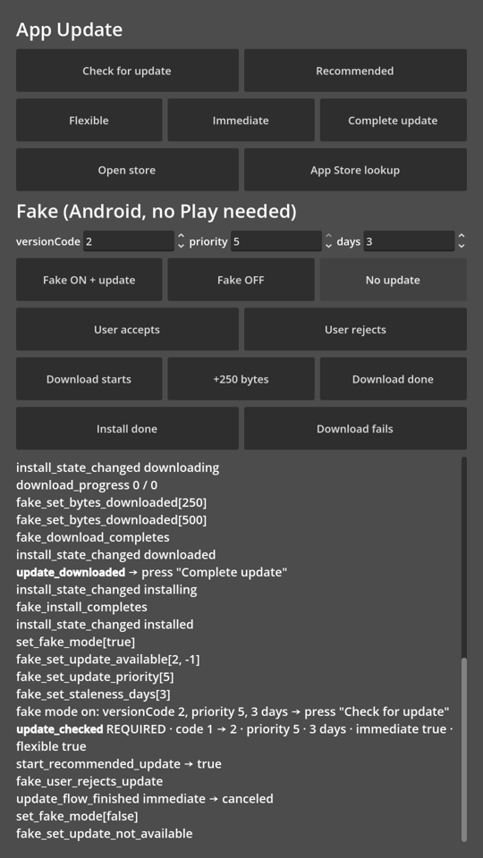

# App Update para Godot 4

**Avise os jogadores que existe uma versão nova do seu jogo e faça ela ser instalada.**

- **Android:** [Google Play In-App Updates](https://developer.android.com/guide/playcore/in-app-updates):
  a própria tela cheia de "atualizar agora" do Play (**immediate**) ou um download em segundo plano que
  instala quando você mandar (**flexible**).
- **iOS:** consulta a versão publicada na App Store e abre a página da loja. (O iOS não tem API de
  atualização dentro do app; o seu jogo mostra o próprio diálogo.)
- **Uma única API em GDScript** para os dois (autoload `AppUpdate`), com uma política embutida que decide
  se uma atualização é **opcional** ou **obrigatória**.
- **Dá para testar sem o Play:** um modo fake (o `FakeAppUpdateManager` do Play) percorre cada etapa do
  fluxo em qualquer aparelho ou emulador.

[Read in English](README.md)



---

## Conteúdo

- [Requisitos](#requisitos)
- [Instalação](#instalação)
- [Início rápido](#início-rápido)
- [Opcional ou obrigatória? A política](#opcional-ou-obrigatória-a-política)
- [Referência da API](#referência-da-api)
- [Definindo a prioridade de atualização no Google Play](#definindo-a-prioridade-de-atualização-no-google-play)
- [Testes](#testes)
- [Solução de problemas](#solução-de-problemas)
- [Compilando o plugin Android](#compilando-o-plugin-android)
- [Como funciona](#como-funciona)
- [Licença](#licença)

## Requisitos

| | |
|---|---|
| Godot | 4.2 ou mais recente (formato de plugin Android v2). Desenvolvido e testado com a **4.7.2**. |
| Android | Exportação com **Gradle build** (`gradle_build/use_gradle_build = true`), minSdk 24. O jogo precisa ter sido instalado **pelo Google Play** para as atualizações reais aparecerem. |
| iOS | O app precisa estar publicado na App Store; configure o bundle id dele nas configurações do projeto. |

## Instalação

1. Copie `addons/app_update` para a pasta `addons/` do seu projeto (ou baixe o zip em
   [Releases](../../releases)).
2. **Project → Project Settings → Plugins** (Projeto → Configurações do Projeto → Plugins): ative
   **App Update**. Isso adiciona o autoload `AppUpdate` e as configurações em **App Update**.
3. **Android:** no preset de exportação Android, ligue **Gradle Build → Use Gradle Build** (instale o
   template de build Android se for pedido: **Project → Install Android Build Template**). O addon
   adiciona sozinho o AAR dele e a dependência do Play (`com.google.android.play:app-update`) na
   exportação.
4. **iOS:** preencha **App Update → iOS → Bundle Id** (o mesmo do preset de exportação iOS) e, se
   quiser, **App Store Id** e **Countries** (veja as [configurações](#configurações-do-projeto)).

## Início rápido

```gdscript
func _ready() -> void:
    AppUpdate.update_checked.connect(_on_update_checked)
    AppUpdate.update_downloaded.connect(_on_update_downloaded)
    AppUpdate.check_for_update()


func _on_update_checked(result: Dictionary) -> void:
    if result.error != "":
        return  # sem internet, não instalado pelo Play, plataforma sem suporte… é só continuar jogando
    match result.kind:
        AppUpdate.UpdateKind.REQUIRED:
            if result.platform == "ios":
                show_update_dialog(true)        # sua UI; o botão dela chama AppUpdate.open_store()
            else:
                AppUpdate.start_recommended_update()   # atualização em tela cheia do Play
        AppUpdate.UpdateKind.OPTIONAL:
            if result.platform == "ios":
                show_update_dialog(false)       # "Uma nova versão está disponível" + "Depois"
            else:
                AppUpdate.start_recommended_update()   # o Play pergunta e depois baixa em segundo plano


func _on_update_downloaded() -> void:
    # Atualização flexible pronta. Instale agora (o app reinicia) ou espere um bom momento,
    # por exemplo, quando voltar ao menu principal.
    AppUpdate.complete_update()
```

Prefere `await`? Também funciona — toda resposta chega depois que a chamada retorna:

```gdscript
AppUpdate.check_for_update()
var result: Dictionary = await AppUpdate.update_checked
```

Quer verificar a cada abertura sem escrever código? Ligue **App Update → General → Check On Start**
e só escute `update_checked`.

## Opcional ou obrigatória? A política

Todo resultado traz `kind`: `NONE`, `OPTIONAL` ou `REQUIRED`. Ele é calculado a partir dos dados da
loja e das configurações do projeto, então **você decide por versão publicada, não por build**.

### Android

O Play dá a cada versão uma **prioridade de atualização** (0–5) e informa há quantos dias a
atualização está disponível (**staleness**). Uma atualização é `REQUIRED` quando:

- a prioridade dela é ≥ **Required Priority** (padrão **4**), ou
- **Required Staleness Days** é ≥ 0 e a atualização já está disponível há pelo menos esse número de dias;

…e o Play permite o fluxo immediate para ela. Qualquer outra atualização disponível é `OPTIONAL`.
Uma atualização immediate que o jogador largou no meio (`in_progress`) é sempre `REQUIRED`, como o
Play pede.

### iOS

A App Store só informa a string de versão, então a regra usa o quanto ela mudou em relação ao seu
`application/config/version`:

| Required When | 1.6.5 → 1.6.6 | 1.6.5 → 1.7.0 | 1.6.5 → 2.0.0 |
|---|---|---|---|
| `major` | opcional | opcional | **obrigatória** |
| `minor` (padrão) | opcional | **obrigatória** | **obrigatória** |
| `patch` | **obrigatória** | **obrigatória** | **obrigatória** |
| `never` | opcional | opcional | opcional |

As versões são comparadas número por número (`1.10.0` > `1.9.3`); o que vier depois dos dígitos de
uma parte (`1.7.0-beta`) é ignorado.

> **Dica:** use a mesma ideia no Android: dê prioridade 5 às versões que sobem o número minor e uma
> prioridade menor às versões patch. Assim as duas lojas se comportam do mesmo jeito.

### Configurações do projeto

| Configuração | Padrão | O que faz |
|---|---|---|
| `app_update/general/check_on_start` | `false` | Chama `check_for_update()` quando o jogo abre. |
| `app_update/android/required_priority` | `4` | Prioridade a partir da qual a atualização é obrigatória. `0` = nunca pela prioridade. |
| `app_update/android/required_staleness_days` | `-1` | Dias depois dos quais uma atualização disponível vira obrigatória. `-1` = desligado. |
| `app_update/ios/bundle_id` | — | Bundle id usado na consulta à App Store. **Obrigatório no iOS.** |
| `app_update/ios/app_store_id` | — | Id numérico da App Store; só é usado para abrir a loja quando a consulta falhou. |
| `app_update/ios/countries` | `us` | Lojas (storefronts) separadas por vírgula, tentadas em ordem (`br,us`). A consulta só encontra apps vendidos naquele país. |
| `app_update/ios/required_when` | `minor` | `major`, `minor`, `patch` ou `never` (tabela acima). |

## Referência da API

### Métodos de `AppUpdate`

| Método | Plataformas | Descrição |
|---|---|---|
| `check_for_update()` | todas | Consulta a loja. Resposta: `update_checked(result)`. Ignorado enquanto uma verificação está em andamento. |
| `start_recommended_update() -> bool` | Android, iOS | O que a última verificação recomenda: no Android, **immediate** quando obrigatória e **flexible** quando opcional (cai no outro tipo se o Play não permitir); no iOS, abre a loja. |
| `start_immediate_update() -> bool` | Android | Atualização em tela cheia do Play. O app reinicia depois de instalado. |
| `start_flexible_update() -> bool` | Android | Diálogo de confirmação do Play e, em seguida, download em segundo plano. |
| `complete_update()` | Android | Instala uma atualização flexible já baixada e reinicia o app. |
| `open_store() -> bool` | Android, iOS | Abre a página do jogo na loja. |
| `is_supported() -> bool` | todas | `true` no Android com o plugin exportado e no iOS com um bundle id. |
| `check_app_store()` | todas | A verificação do iOS, em qualquer plataforma (útil para testar pelo editor). |
| `android_plugin() -> Object` | Android | O singleton `GodotAppUpdate` cru (modo fake, veja [Testes](#testes)). |
| `compare_versions(a, b) -> int` | static | `-1`, `0` ou `1`. |
| `version_change(from, to) -> String` | static | `"major"`, `"minor"`, `"patch"` ou `"none"`. |
| `last_result: Dictionary` | todas | O último resultado de `update_checked`. |

Os `start_*` retornam `false` quando não há nada para iniciar (nenhuma verificação ainda, nenhuma
atualização, tipo não permitido). Um `AppUpdateInfo` do Play só consegue iniciar um fluxo, então
**verifique de novo** antes de iniciar outro.

### Sinais

| Sinal | Descrição |
|---|---|
| `update_checked(result: Dictionary)` | Resposta de `check_for_update()` / `check_app_store()`. Sempre emitido depois que a chamada retorna. |
| `update_flow_finished(type: String, result: String)` | Android: a tela de atualização do Play fechou. `type`: `flexible`/`immediate`; `result`: `ok`, `canceled`, `failed`. |
| `download_progress(bytes_downloaded: int, total_bytes: int)` | Android flexible: progresso do download. |
| `update_downloaded()` | Android flexible: pronta para instalar → `complete_update()`. Também é emitido por uma verificação quando há um download anterior esperando. |
| `install_failed(error_code: int)` | Android flexible: o download/instalação falhou (`InstallErrorCode` do Play). |
| `install_state_changed(state: Dictionary)` | Android: todo estado de instalação cru (`status`, `status_name`, `bytes_downloaded`, `total_bytes_to_download`, `error_code`, `package_name`). |

Todos os sinais chegam na thread principal.

### Dicionário de resultado

| Chave | Tipo | Descrição |
|---|---|---|
| `platform` | String | `android`, `ios` ou o nome do sistema operacional. |
| `supported` | bool | `false` quando esta plataforma/build não consegue verificar. |
| `available` | bool | Há uma versão mais nova na loja. |
| `kind` | int | `AppUpdate.UpdateKind`: `NONE`, `OPTIONAL`, `REQUIRED`. |
| `current_version` | String | `application/config/version`. |
| `store_version` | String | iOS: versão na App Store. |
| `available_version_code` / `current_version_code` | int | Android: versionCode oferecido pelo Play / em execução. |
| `update_priority` | int | Android: 0–5. |
| `staleness_days` | int | Android: dias desde que o Play recebeu a atualização; `-1` = desconhecido. |
| `immediate_allowed` / `flexible_allowed` | bool | Android: fluxos que o Play permite para esta atualização. |
| `install_status` | String | Android: `pending`, `downloading`, `downloaded`, `installing`, `installed`, `failed`, `canceled`… |
| `store_url` | String | iOS: a página do jogo na App Store. |
| `error` / `error_code` | String / int | Vazio / `0` quando a verificação funcionou. |
| `raw` | Dictionary | O que a loja respondeu, sem alterações. |

### Plugin Android (singleton `GodotAppUpdate`)

Usado pelo autoload; chame direto só para coisas que o autoload não cobre.

| Método | Descrição |
|---|---|
| `check_update()` | → `update_info_received(info)` / `update_info_failed(code, message)` |
| `start_update(type: int) -> bool` | `0` flexible, `1` immediate → `update_flow_finished(type, result)` |
| `complete_update()` | Instala uma atualização flexible já baixada. |
| `get_current_version_code() -> int` | versionCode do app em execução. |
| `open_store_page() -> bool` | Página do app na Play Store. |
| `set_fake_mode(enabled: bool)`, `is_fake_mode() -> bool` | Troca para o `FakeAppUpdateManager` do Play. |
| `fake_*` | Veja [Testes](#testes). |

O plugin também segue sozinho as regras de ciclo de vida do Play: quando o app volta para o primeiro
plano, ele **retoma uma atualização immediate interrompida** e avisa sobre uma atualização flexible
que **terminou de baixar em segundo plano**.

## Definindo a prioridade de atualização no Google Play

O Play Console **não tem campo** para isso: a prioridade é definida quando a versão é criada pela
[Google Play Developer API](https://developers.google.com/android-publisher/api-ref/rest/v3/edits.tracks)
(`inAppUpdatePriority` na release da track, 0–5). Ela não pode ser alterada depois que a versão é
lançada.

```json
{ "releases": [{ "versionCodes": ["54"], "status": "completed", "inAppUpdatePriority": 5 }] }
```

Ferramentas como o [fastlane supply](https://docs.fastlane.tools/actions/upload_to_play_store/)
(`in_app_update_priority`) ou o Gradle Play Publisher (`updatePriority`) também definem a prioridade.
Sem prioridade (0), só o **Required Staleness Days** consegue tornar obrigatória uma atualização no
Android.

## Testes

### Modo fake — qualquer aparelho, sem Play

O `FakeAppUpdateManager` do Play simula tudo localmente. Nada aparece na tela (não existe UI do Play);
você faz o papel do usuário e do Play:

```gdscript
var p := AppUpdate.android_plugin()
p.set_fake_mode(true)
p.fake_set_update_available(55, -1)    # versionCode 55; -1 = os dois fluxos permitidos (0 flexible, 1 immediate)
p.fake_set_update_priority(5)
p.fake_set_staleness_days(3)
AppUpdate.check_for_update()           # → REQUIRED
# depois de start_flexible_update():
p.fake_user_accepts_update()           # → update_flow_finished("flexible", "ok")
p.fake_download_starts(1000)           # → install_state_changed(downloading)
p.fake_download_completes()            # → update_downloaded
AppUpdate.complete_update()            # → installing
p.fake_install_completes()             # → installed
```

Outros controles: `fake_set_update_not_available()`, `fake_user_rejects_update()`,
`fake_set_bytes_downloaded(n)` (informado na próxima mudança de estado), `fake_download_fails()`,
`fake_user_cancels_download()`, `fake_install_fails()`, `fake_is_immediate_flow_visible()`,
`fake_is_confirmation_dialog_visible()`. `set_fake_mode(false)` volta para o Play.

O **projeto de demonstração** deste repositório tem um botão para cada um deles (captura de tela acima).

### Atualizações reais

1. Envie a versão **N** para uma track de teste (o teste interno é o mais rápido) e instale-a **pela
   Play Store** no celular de teste.
2. Envie a **N + 1** (com a prioridade que você quiser) para a mesma track.
3. Abra o app da Play Store uma vez (o cache dele decide quando a atualização é "vista") e depois abra
   o jogo.

O [compartilhamento interno de apps](https://support.google.com/googleplay/android-developer/answer/9844679)
também funciona: instale a N por um link, depois abra o link da N + 1, mas **não** toque em atualizar.

### iOS

`AppUpdate.check_app_store()` roda em qualquer plataforma. No editor, configure o bundle id de um app
publicado e coloque `application/config/version` abaixo da versão da loja para ver `OPTIONAL` /
`REQUIRED`.

## Solução de problemas

| Sintoma | Causa |
|---|---|
| O Android sempre responde `NONE` | O app não foi instalado pelo Play (adb, arquivo APK), a conta do Play não tem acesso à versão mais nova (tracks de teste) ou o cache da Play Store ainda não a viu — abra o app da Play Store. |
| `update_info_failed` com código `-10` | `ERROR_APP_NOT_OWNED`: não foi instalado pelo Play. |
| `update_info_failed` com código `-100` / `no activity` | A verificação rodou antes de a activity Android existir. Chame em `_ready()` ou depois. |
| `start_*` retorna `false` | Nenhuma verificação ainda, o tipo de atualização não é permitido (veja `immediate_allowed` / `flexible_allowed`) ou o resultado já foi usado para iniciar um fluxo — verifique de novo. |
| iOS: `app not found in the App Store` | Bundle id errado, o app ainda não foi publicado ou não é vendido nas lojas de **Countries**. |
| O iOS mostra a atualização com horas de atraso | A Apple faz cache da API de consulta; uma versão nova pode levar algumas horas para aparecer. |
| Exportação: "Android build template not installed" | **Project → Install Android Build Template** e ative **Use Gradle Build**. |

## Compilando o plugin Android

O repositório já traz os AARs compilados em `addons/app_update/bin/`. Para compilá-los de novo (é
preciso ter o Android SDK):

```bash
cd android_plugin
./gradlew copyToAddon        # compila debug + release e copia para addons/app_update/bin
```

As versões ficam em `android_plugin/plugin/build.gradle.kts` (`godotVersion`, `playAppUpdateVersion`).
Se mudar a versão da biblioteca do Play, atualize também `ANDROID_DEPENDENCIES` em
`addons/app_update/plugin.gd`.

## Como funciona

```
seu jogo ──► AppUpdate (autoload, GDScript)
                 ├─ Android ─► GodotAppUpdate (plugin Kotlin) ─► Play In-App Updates (AppUpdateManager)
                 └─ iOS ─────► HTTPRequest ─► itunes.apple.com/lookup ─► OS.shell_open(página da loja)
```

- `addons/app_update/plugin.gd` — plugin do editor: autoload, configurações do projeto, exportação
  Android (AAR + dependência `com.google.android.play:app-update`).
- `addons/app_update/app_update.gd` — o autoload `AppUpdate`: API unificada, política, consulta do iOS.
- `android_plugin/` — projeto Gradle do plugin Kotlin.
- `demo/` — cena de demonstração (este repositório também é o projeto Godot de demonstração).

## Licença

[MIT](LICENSE) © Alex W Baulé
